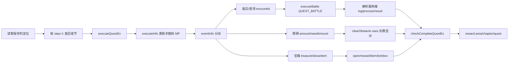

# 第二轮：遭遇、推进、战斗与结算

本轮新增真正的资源写入/障碍解除模块，不止响应查询；但没有以部分模块冒充完整物语。
`AdventureObstacleServices` 独立注册 getQuestEncountWorks 和 clearObstacle，仍未生产挂载。
完整原版推进、战斗运算、发奖、活动排期仍未复原。

## 原客户端可证链路

箭头表示客户端消费者关系，不是已恢复的服务端转移条件。

1. **定位/费用新证据**：QuestAreaTableAccessor.cs:282-307 用 `step+1` 遍历 section，
   累加 stepCount，遇到负值视为尾节；并非 `section=step`。
   QuestStoryAreaConfirm.cs:331-354 从当前节向前找第一个非空、非负 cost，
   然后加 QuestDataCache.getAddStepCost；找不到返回 -1。原新手第1节 cost=1，
   后9节空字符串，因此十节菜单费用都是1。此为菜单逻辑，尚不证明服务端扣MP/恢复顺序。
   已提供可复用 section_at/displayed_cost 并用十条未修改原表行测试，不重新写提取器。
2. **推进**：WebApiClient.cs:1773-1783 只有 questType/questId/chapterId/areaId/assets 和 token，
   没有步数或幂等键。sendRequest:190-216 失败时最多10次重发同一表单；_httpCall:247-276
   的 httpCallId 只用于本地跟踪，没有传给服务端。
   因此按请求参数永久缓存会阻止下一步，按每次请求推进又可能重复扣费。未解决前不开放推进。
3. **遭遇**：processStepEvent:490-540 先更新 executeInfo，再根据 eventInfo.eventType 分派。
   敌兵/首领读取 monsterId/encountId；恢复读取 `<type>.questId/chapter/area/step`。
   `getQuestEncount` 的 entry 非空会阻止恢复，不可把所有遭遇都塞进同一空模板。
4. **战斗**：PluginQuestStepHelper.cs:271-309 用保存的 encountId 调用 QUEST_BATTLE，
   从 log.winner 判断结果，消费 result.bonus/payment。BattleLogManager.cs:3249-3312
   将服务端 process 数字键排序，再消费 beginBattle/beginRound/beginTurn/endBattle；
   :5563-5582 读取 log/information/process/result。
   :4539-4567 所见 Random.Range 位于语音预加载，不能拿它补伤害、暴击或胜负公式。
   BattleQuestResult 仅保存布尔结果，BattleEventIP_Initialize 的回调为空；这些都不是战斗计算器。
   本轮没有证明整个原包绝无其他运算，只明确当前追踪链路未提供可用的权威算法。
5. **障碍**：QuestScriptCommand.cs:724-732 读当前余额和所需数量；:2189-2207
   成功后必读 uses，:2212-2232 对四资源取 uses.<resource> 的负值，:2287-2289 更新显示。
   因而此前只记录 isSuccess/reward/toInbox 的契约不完整，已修本组清单。
   PluginQuestStepHelper.cs:197 的自动插件用严格 `>` 判断余额；普通脚本共享钥匙检查
   QuestScriptCommand.cs:1718-1723 用 `<=`。本模拟服采用余额足够（>=）允许支付，
   **这是明确的兼容决策，不宣称已证实原服务端等额余额行为**。
6. **结算**：checkAreaComplite:1769-1794 的 maxStep/末区域/末章节判断只是客户端触发条件；
   processQuestResult:993-1040 还要求服务器响应含 reward 才清理客户端 step，并读取三层奖励。
   不能直接用 `step>=maxStep` 发奖：尾节可能还有首领，且领取账本、首次奖励、重复奖励未证。
7. **开箱**：普通UI读 open/reward/toInbox；插件 PluginQuestStepHelper.cs:340-345 还读根 item。
   useItem 为空也会调用，不能把它当作无条件免费开箱；概率、退钥匙与容量处理继续待证。

## 本轮已实现的限定写入

文件 `app/business/adventure_obstacle_services.py`：

- getQuestEncountWorks 投影已生成的资源障碍，amount 每次取玩家实际余额；不回陈旧库存。
- clearObstacle 验证认证账号内的实例、位置、原表事件槽与受信任结算描述。
- 仅支持 gold/food/wood/iron，明确无奖励且无信箱发放的结算。缺 reward/toInbox 描述
  与非空奖励都会拒绝，**不会从字段缺失推导“无奖励”**。
- pending→cleared，扣资源并记重试凭据，一次玩家 save 提交；失败不修改持久状态。
  不改MP、step、完成标记或领奖标记，也不调用公共奖励函数。
- 请求不含实例ID，因此只支持每账号每 type/quest/chapter/area 一次解除。
  同一区域新实例与已有凭据冲突就拒绝，不让旧请求误扣新障碍；不支持活动轮回。
- 重试返回相同 uses 业务负载，now 沿用现有信封时钟；重登和不同服务实例的CAS竞争均测试。
  同一客户端反复主动重放成功回包可能重复应用显示增量，需总集成在动态验收时核对刷新行为。

**两个前提尚无生产实现**：可信遭遇生产者、可信活动授权。构造器 authorize 默认 None，
会明确失败；测试中的 True 是测试替身，绝不能复制为生产策略。
授权者必须确认该账号当前有权解除该活动实例，同时核实其 resolution 的无奖励描述。
授权者接收副本，不能借授权回调改玩家存档。内部 eventId/section/eventSlot/resolution/status/
obstacleReceipts 是本服务设计，不是新增客户端请求字段。

扫描原包发现185个 obstacle 槽，全部所在索引 enable=false：resource144、potion37、soul4。
本包没有可自动放行的障碍活动。原表 event 数组后3项与 category/type/needAmount 的对应
用于校验受信任描述，是响应语义与原行的一致性推断，**不充当授权/费用生成器**。
不把旧1999排期改成2026，也不把测试合成实例说成原版真实遭遇。

## 后续必须解决的事务边界

- 推进：定位/MP/生成遭遇/直接奖励一次提交；缺可靠重试识别和采样规则，暂不接路由。
- 战斗：校验遭遇归属与状态/合法编队→权威运算→过程快照→奖励账本一次提交；
  同 encountId 的重试应读原结果，而非重算。如何处理原版失败后可重战仍需原始证据。
- 结算：依已完成事件与未领账本处理 area/chapter/quest 奖项；C提供库存/奖励事务契约，
  不能直接复制既有取 countMin 的函数作为随机奖励算法。
- 多人首领：不是单玩家save可以解决；仍需总集成共享事务方案。

验证使用内存账号与原表小样本，没有运行共享客户端，没有部署、改 hosts 或其他组。
