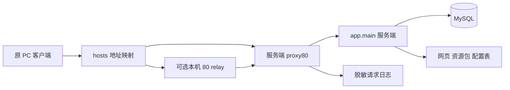

# 架构说明

本页描述当前分层，玩法支持范围见 [系统台账](project-status/README.md)，
后续职责拆分见 [重构清单](repository-maintenance.md)。

## 运行拓扑

- 云端模板的 stub 监听 `127.0.0.1:18080`，对外仅 80 端口代理；MySQL 默认回环 3306，真实库/账号由环境注入。
- 独立本地测试使用 stub 18081、代理 18082、MySQL 3307，数据库为独立的 `onisoul_local_test`。
  本机网关 80 在游戏关闭后选择本地代理或云端链路，先核对运维环境身份。
- 云端 relay 模式经过本机和云端两段转发；局域网及云端直连配置分别核对，不共用一套地址假设。
- 登录保存助手在玩家电脑上运行，数据库/游戏逻辑在服务器运行；离线媒体转换和运行时客户端补丁另有独立流程。

## 分层（app/）

| 层 | 模块 | 职责 |
|---|---|---|
| transport | `transport/http_server.py` | HTTP 路由、请求体读取、会话解析、响应写出 |
| transport | `transport/static.py` | PC Web、AssetBundle、缓存包与 crossdomain 静态路由 |
| transport | `transport/login_page.py` | 当前还混合网页渲染、密码校验和 users 表访问，列入职责拆分 |
| protocol | `protocol/envelope.py` | 参数解析（JSON body / 表单 `params`）、统一响应、错误码 |
| sessions | `sessions/sessions.py` | token ↔ account ↔ player；过期清理；`accounts` / `sessions` 表 |
| state | `state/player.py` | 玩家状态整行 JSON 读写；`players` 表 |
| state | `state/transactions.py` | 多玩家和共享记录同连接事务、锁序与版本保护 |
| business | `business/registry.py` | api 路径 → handler 注册表；业务规则在此逐个实现 |
| business | `business/response_shapes.py` | 区分普通 envelope 与客户端要求的裸映射响应 |
| business | `business/gameplay.py` | 登录、角色初始化、主城、建造和已支持的任务处理；并装配部分子服务 |
| business | `business/mission_chain.py` | 按 `politicMission.json` 计算任务状态与解锁位 |
| business | `business/tutorial_production.py` | 任务 5 的受限田地开工/收获，复用存档和原表；不开放通用生产 |
| tables | `tables.py` | 按客户端、服务端和动态关卡清单加载 JSON，校验 root key 并热重载 |
| 装配 | `main.py` | 读配置、建注册表、起 HTTP 服务；可选 `--init-schema` 建表 |

## 数据流（POST /api/<api>）

1. `http_server` 读 body，`envelope.parse_params` 解析参数字典。
2. 取 `token`，`sessions.resolve` 校验会话（过期返回 None）。
3. 传输层先做鉴权，再由 `Registry.dispatch(api, params, session)` 查找处理器。
   未知接口 404；已知占位通常返回 200 默认值，部分写入和管理入口明确拒绝。
   处理器主动抛 `NotImplementedError` 才映射 501，其他未处理异常映射 500。
4. handler 返回最终响应 dict；普通接口经 `response_shapes.success` 注入
   `succeeded` / `now`，裸映射接口不注入。

生产注册表先登记真实玩法 handler，再用契约占位补齐全量 402 端点。
登录与玩家状态依据账号对应的 `players.state_json`，不使用全局新号/老号开关。
哪些处理器实际启用见 [业务索引](../app/business/README.md)，不能用目录内文件数量判断。

## 运行时读取的文档清单

`business/contract.py` 直接读取 `docs/analysis` 下的 `api_contract.tsv`、
`behavior_contract.tsv`、`api_call_graph.tsv`。
`tables.py` 读取同目录的 `table_list.tsv`、`server_tables.tsv`、`quest_tables.tsv`。
整理文档时这些文件必须保持可用；后续会在独立重构中迁移路径和调用方。

## 静态请求

- `/client/app.html`、`/client/UnityObject.js` 等映射到 `ONI_PC_WEB_DIR`。
- `/client/pc/jp/assets|assets2/...` 优先查 `ONI_PC_BUNDLE_DIR`，再查
  `ONI_PC_CACHE_DIR`；支持多级路径、根级 bundle 与 `<category>__<name>` 缓存命名。
- `/crossdomain.xml` 没有本地覆盖文件时返回内建 Unity Web Player 策略。
- `/`、`/app.html` 映射到 PC Web 的 `client/app.html`；GET/HEAD 均支持
  `Last-Modified`、`If-Modified-Since` 与单段 `Range`。
- 所有路径都解析后校验仍在配置根目录内，目录穿越返回 400。

## 持久层模型

- `accounts(account_key PK, player_id UNIQUE, created_at, last_seen)`
- `sessions(token PK, account_key, player_id, created_at, last_seen, expires_at)`
- `players(player_id PK, state_json JSON, updated_at)`
- `players.username_key` 从 JSON 中提取非空昵称，建立精确字节唯一索引；player_id 仍是稳定主键。
- `shared_records(namespace, record_key, state_json, revision, updated_at)`：服务端内部共享状态/事务记录。
- `users(account_key, password_hash, salt, created_at)`：登录凭据。目前由 `login_page.py` 中的 DDL 创建，
  尚未统一纳入 `db/schema.sql`；这是待重构事项。

玩家状态是嵌套 dict，按 `player_id` 整行序列化为 JSON 存储；业务层仍按 dict 操作，
持久层不拆关系表。时间字段统一 epoch 秒（DOUBLE）。状态 JSON 带 `_revision`，
`save()` 使用行锁和版本比较拒绝陈旧快照。
调用方的 `_revision` 仅在提交成功后更新。序列化、SQL 写入或提交抛异常时保留
原版本号，避免一次失败保存让下一次重试误报版本冲突。若提交结果因连接中断
而不确定，需重新加载数据库状态后判断，不能把此保证理解为业务操作可以盲目重放。
跨玩家操作由 `state/transactions.py` 统一锁定声明的玩家/共享键，同行事务提交；
好友已使用该边界，其他候选模块仍须完成各自适配。

## 未决 / TODO

- 当前接口使用 JSON；不能仅因原包出现其他编码库就把它列成必须实现的玩法依赖。
- 客户端包内无法取得的配置表仍需外部证据：`combo.json`、
  `strategy_battlefield.json`。
- 业务字段和规则依原客户端证据推进，未实现项按 [系统台账](project-status/README.md) 管理。
- 当前服务端依赖清单未使用 Redis；是否引入缓存需由实际性能或一致性需求决定。
